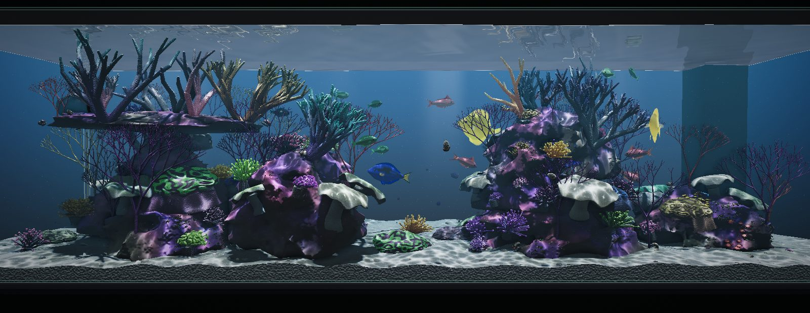
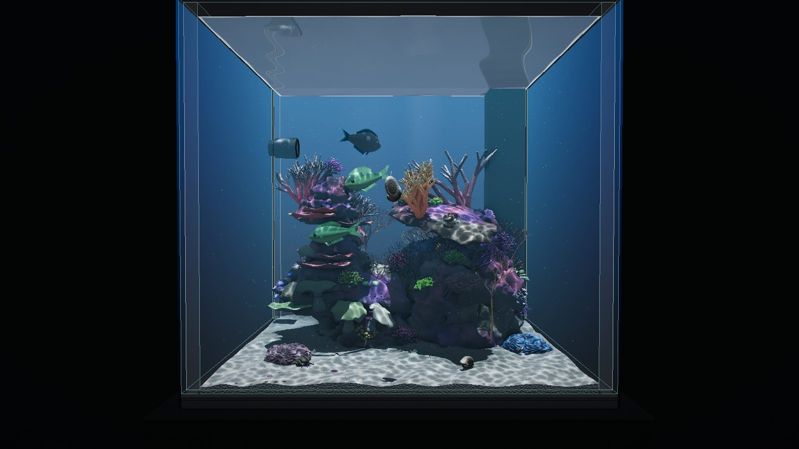
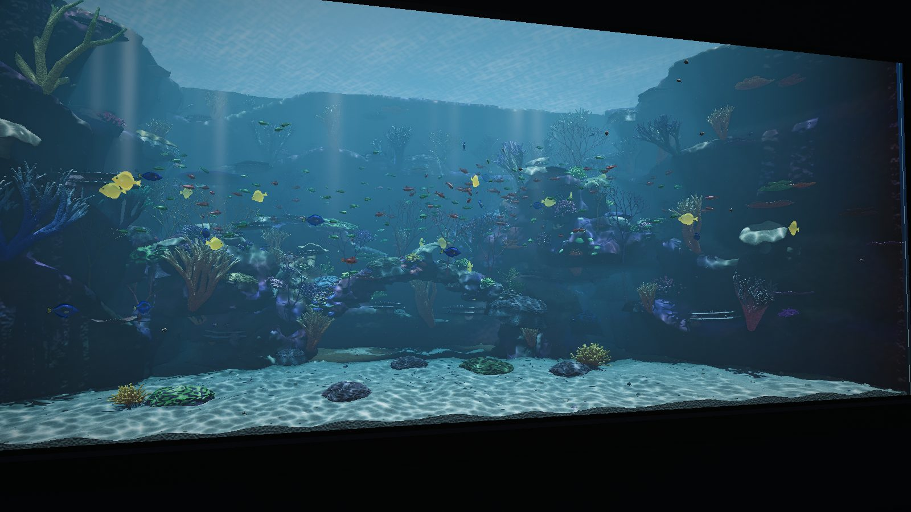
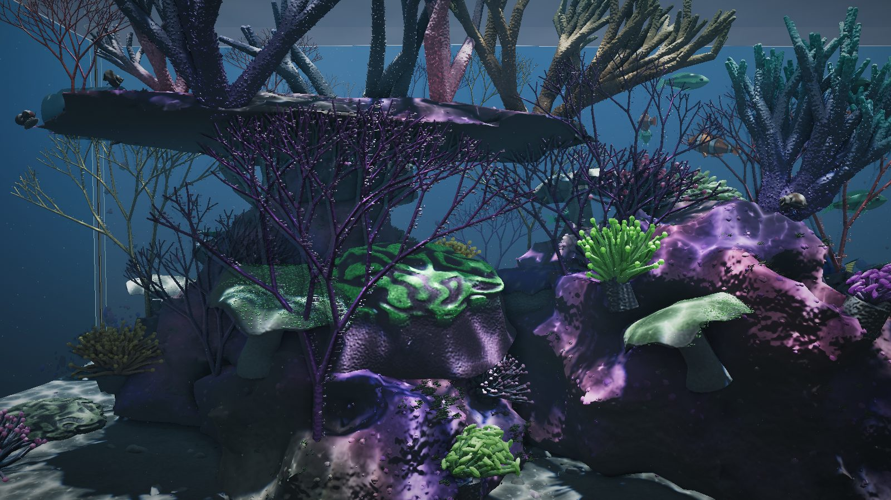
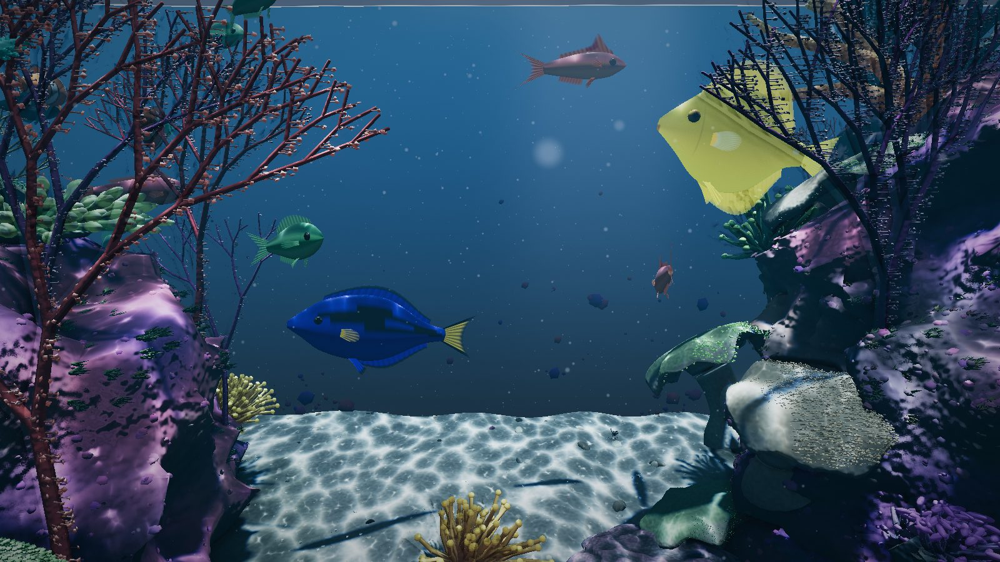
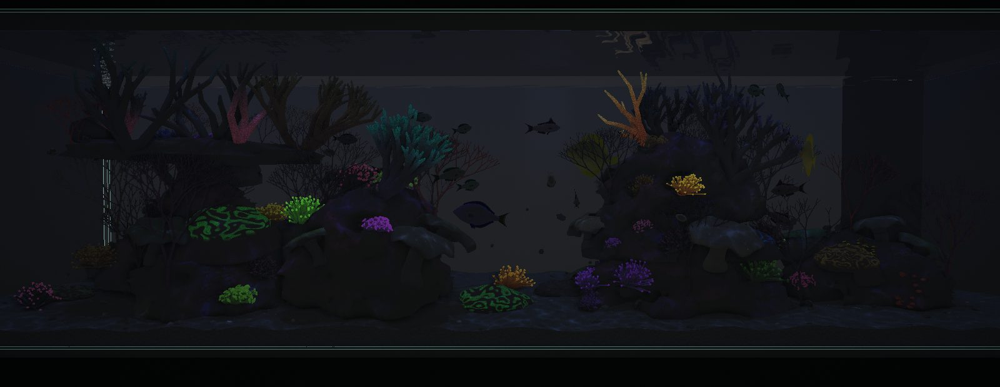
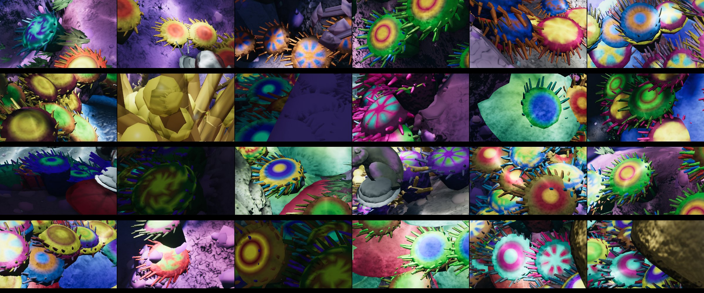

# Reef Studio



A living saltwater reef aquarium that grows in your browser. Pick a tank, press Enter, and watch fish school past coral heads while a cleanup crew of crabs and snails works the sand. Light it, tour it, or swim right through it.

**The whole thing fits in one HTML file of about 96 KB.** Every coral, fish, rock, grain of sand, light ray and water sound is made by code. There are no images, no 3D models and no sound files. Open `index.html` and the reef is grown from scratch, a little differently for every seed.

To be honest about that number: it does not include [three.js](https://threejs.org) (the 3D library), which is loaded once from a CDN the first time you open the page. Everything else is in the file.

## Try it

Open `index.html` in Chrome, Edge or Firefox. That is all. It needs an internet connection the first time, to fetch three.js (your browser caches it after that). A computer with a graphics card gives the best picture; phones work too, on a lower detail level.

You can also link straight to a reef:

```
index.html?tank=nano&seed=4821            start screen with that tank and seed ready
index.html?tank=large&seed=77&go=1        skip the start screen and go in
index.html?tank=home&view=showcase        start the showcase tour right away
```

`tank` is `nano`, `home`, `large` or `exhibit`. `view` is `showcase`, `front`, `corner`, `inside`, `swim` or `follow`. The **Copy link** button in the side panel builds one of these for the reef you are looking at.

## What's in it

- **Four tank sizes.** A 24 gallon nano cube, a 300 gallon home tank, a 1,000 gallon display, and a **public exhibit** with a 9 metre window onto a reef wall that you view from the gallery. The side panel also has presets from 24 to 3,000 gallons and sliders for any size in between.
- **Showcase tour.** A documentary-style camera that glides along the glass, drops to the sand, follows a school of fish, and lingers on a crab, with soft fades between shots.
- **Walk and swim.** Orbit the tank from outside, step inside the gallery, or switch to swim mode and fly through the reef with WASD.
- **Lighting and a day cycle.** Daylight, Reef 20K, Actinic and Moon presets, per-channel LED sliders, and a slow cycle through actinic dawn, day, actinic dusk and moonlight. Many corals fluoresce under blue light, just like the real thing.
- **Corals.** Branching and tabling Acropora, brain corals, toadstools, gorgonians, anemones, clams, mushrooms, and zoanthid colonies in hundreds of generated colour morphs.
- **Fish and a cleanup crew.** Yellow and blue tangs, chromis and anthias in schools, a royal gramma, a mandarin, damsels and clownfish that host in anemones, plus crabs and snails working the sand and rock.
- **Aquascapes.** Two islands, single island, archipelago with an arch, reef wall, caves. Pick the sand, the rock type and the reef style (mixed, SPS, softies, LPS, zoa garden, clownfish and anemones, fish only).
- **Ambient sound.** A quiet pump hum, water movement and bubbles, made live with the Web Audio API. It gets fuller as you move toward the glass.

## Screenshots

| | |
|---|---|
|  |  |
| A 24 gallon nano cube | The public exhibit, seen from the gallery |
|  |  |
| A close-up of the rockwork | Swim mode |
|  |  |
| Moon lighting, with the corals glowing | A few of the zoanthid colour morphs |

## Controls

| Input | What it does |
|---|---|
| Drag | Orbit around the tank (in look mode, turn the view) |
| Scroll | Zoom in and out (in look mode, step forward or back) |
| `1` `2` `3` `4` | Front, corner, top and inside views |
| `5` | Start or stop the showcase tour |
| `6` | Swim mode |
| `7` | Follow a fish |
| `W` `A` `S` `D` | Walk or swim forward, left, back, right |
| `Q` `E` | Down and up |
| `Shift` | Move faster |
| `L` | Cycle the lighting |
| `H` | Hide or show the side panel |
| `F` | Frame statistics |
| `M` | Sound on or off |
| `Esc` | Back to the menu (also leaves swim mode) |

**Touch.** Drag to orbit and pinch to zoom. In swim mode, hold to move forward and slide to steer. The menu button is at the top right. If you hold a phone upright, the page turns itself sideways so the reef always shows in landscape.

**Detail levels.** Low, Medium and High, on the start screen under Settings and in the side panel under Quality. The first visit picks one for your device, and if a visit ever fails to finish loading, the next one starts a level lower. The frame rate also adjusts the render resolution on the fly.

## How it works

Everything is procedural. The rock is a noise-sculpted surface with a heightmap for the sand; corals are grown from small generators (branches, plates, polyps, tentacles) and scattered by rules; fish are built from a few profile curves per species and animated with steering behaviours; the water, caustics, light rays and fluorescence are shaders. The same seed always grows the same reef.

It is [three.js](https://threejs.org) for the 3D, the Web Audio API for sound, and plain HTML and CSS for the interface. The readable source is one file, `reef-studio.html`. The build packs it into one smaller file, `index.html`.

**How small?**

| File | Size |
|---|---|
| `reef-studio.html`, the readable source | about 212 KB |
| minified (names shortened, whitespace gone) | about 167 KB |
| `index.html`, packed (the script is deflate-compressed inside the page) | about 96 KB |
| `index.html` after gzip, as most servers send it | about 64 KB |

`npm run build` prints these numbers each time. three.js is not counted, because the page loads it from a CDN.

## Make it your own

You need [Node.js](https://nodejs.org) to build, and Python 3 if you want the little local server.

```
npm install
npm run build       # writes index.html from reef-studio.html
npm run serve       # serves this folder at http://localhost:8781
```

| File | What it is |
|---|---|
| `reef-studio.html` | The readable source: page, styles and all the code. Edit this one. |
| `index.html` | The packed page the build writes. Open this one, or publish it. |
| `scripts/build.mjs` | The build: minifies, packs and writes `index.html`. |
| `scripts/smoke.mjs` | `npm run test:smoke` loads both pages in Chrome and checks for console errors. |
| `serve.py` | A tiny no-cache static server for local work. |
| `.github/screenshots/` | The pictures in this README. |

A few easy things to change in `reef-studio.html`:

- `P`, the default settings: tank size (`W`, `D`, `H` in metres), `seed`, `scape`, `style`, `sand`, `rtype`, and the sliders `rock`, `coral`, `fish`, `crew`, `haze`.
- `TK`, the four tank cards on the start screen. Add a row with a name, a caption and the three dimensions.
- `MODES`, the lighting presets (sun colour, intensity, fluorescence, water colour).
- `ZP`, the zoanthid hue pairs. Add a pair of hues from 0 to 1 and new morphs appear in the tanks.
- `GITHUB_URL`, the address behind the GitHub link in the footers. Leave it empty to hide the link.

Reload the page after an edit. Run `npm run build` when you want a fresh `index.html`.

## License

Creative Commons Attribution-NonCommercial 4.0 ([CC BY-NC 4.0](https://creativecommons.org/licenses/by-nc/4.0/)). You may share and adapt it with credit, for non-commercial use. See `LICENSE`.

© Robert Gourley

If you enjoy it, you can [buy me a coffee](https://ko-fi.com/robertgourley).
